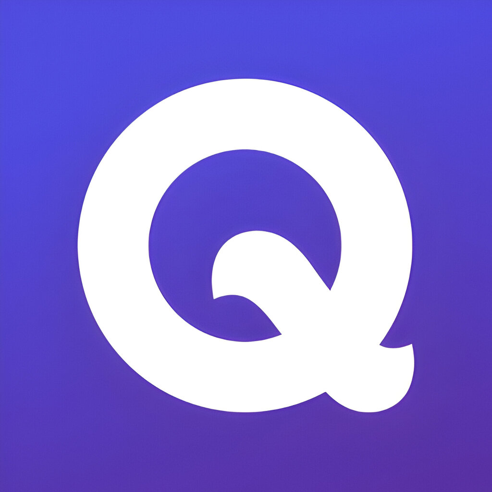
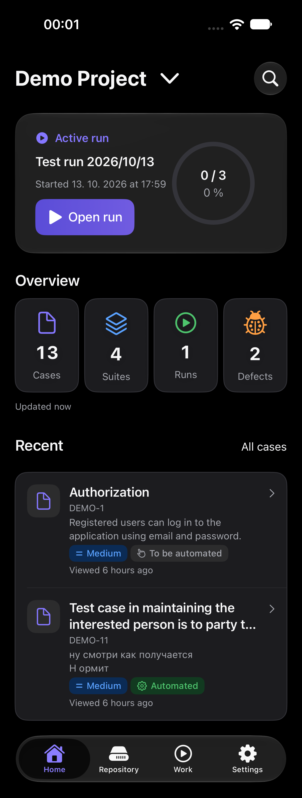
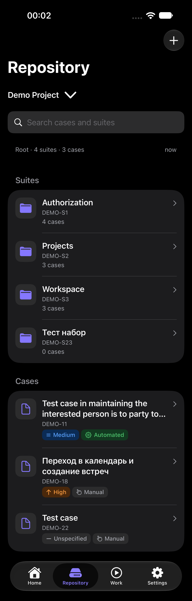
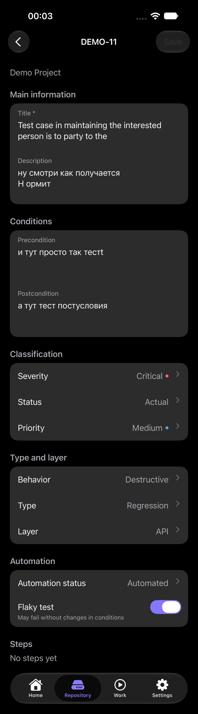
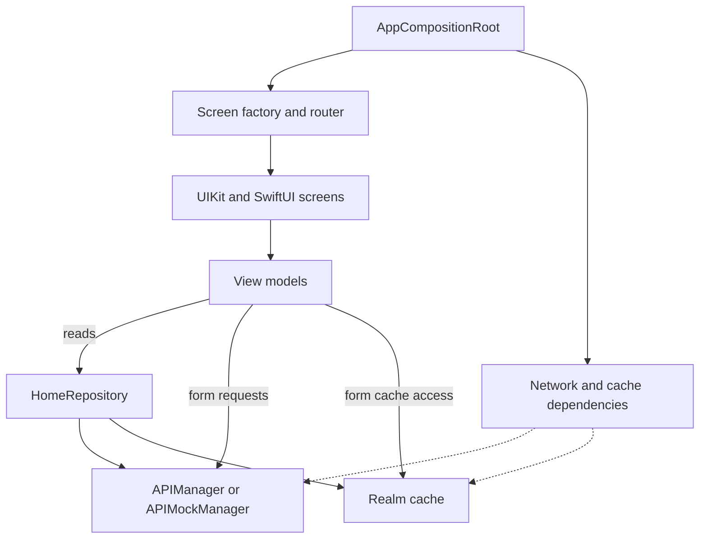

# Qase Mobile

## Overview

An unofficial iOS client for Qase TMS, built for browsing projects and maintaining test documentation from an iPhone. It brings project summaries, a hierarchical test repository, case editing, and run and defect details into a native interface.

The app supports personal API tokens and a local demo that works without a Qase account.

**[Source code — develop](https://github.com/ivn-srg/iOSPetProjectWithQaseAPI/tree/develop)** · **iOS 18.6+**

## My Role

This is a solo project. I handled the product idea, screen structure, UI, architecture, API integration, and network layer, connecting my iOS development work with QA workflows.

## Current Capabilities

- **Account and projects:** sign in with an API token, replace it from Settings, sign out, and browse, select, create, or delete projects. Real credentials are stored in Keychain; replacement tokens are validated before the active credentials change.
- **Project home:** view case, suite, run, and defect counts, open the active run, and return to recently viewed cases.
- **Test repository:** navigate nested suites and breadcrumbs, search cases and suites, load additional results, and delete suites or cases with confirmation.
- **Documentation forms:** create suites and cases with a parent suite selection; edit case text, preconditions, postconditions, and classification and automation properties. Existing steps and expected results, including nested steps, can be viewed.
- **Work:** browse run and defect lists and details, inspect run progress, and open associated cases.
- **Preferences and saved data:** choose light, dark, or system appearance, use English or Russian through iOS language settings, and clear downloaded cache while keeping the active session, project selection, and viewing history.

### Try Demo

1. Download the [develop branch](https://github.com/ivn-srg/iOSPetProjectWithQaseAPI/tree/develop) and open `QaseAPIProj.xcodeproj` in Xcode.
2. Let Swift Package Manager resolve the dependencies, select the `QaseAPIProj` scheme, and run it on an iOS 18.6+ simulator or device. Configure your Signing Team for a physical device.
3. Tap **Try demo** on the sign-in screen. No account or API token is required.

Demo uses bundled JSON data, local mock operations, and an isolated Realm store in memory. It makes no requests to Qase; demo edits are temporary. See the [development guide](https://github.com/ivn-srg/iOSPetProjectWithQaseAPI/blob/develop/docs/DEVELOPMENT.md) for setup details.

## Screenshots

Current simulator captures in dark appearance. Long captures show the full screen content; sample test content is for illustration. Click any image to open its original size.

<strong>Project home</strong>

<strong>Test repository</strong>

<strong>Settings</strong>

More screens: sign-in, case editing, steps, creation, runs, and defects

<strong>Sign-in and demo entry</strong>

<strong>Case editor</strong>

<strong>Steps and expected results</strong>

<strong>Suite creation</strong>

<strong>Run details</strong>

<strong>Defects</strong>

## Tech Stack

| Technology | Role |
| --- | --- |
| Swift, language mode 5 | Application logic and models |
| UIKit + SwiftUI | UIKit navigation, authentication, and forms; SwiftUI Home, Repository, Work, and Settings |
| SnapKit | UIKit layout |
| URLSession + async/await | Qase API requests and asynchronous loading |
| Realm Swift | Local cache for downloaded data and viewing history |
| Keychain | Real API credentials |
| Swift Package Manager | Dependency management with pinned revisions |
| MVVM + explicit dependency injection | Screen state and application composition |
| Swift Testing + XCTest | Unit/regression tests and UI scenarios |

## Engineering Decisions

**Prevent stale responses from crossing sessions.** A request started before logout or token replacement can finish afterward. Models and cache writes check a captured session owner and generation before accepting results; token replacement rebuilds the authenticated dependency graph.

**Keep cache identity and completeness explicit.** Qase entities can share IDs across projects. Cache keys include the local credential owner, project, and entity identity. Full repository snapshots are stored atomically; search results and partial pages do not overwrite complete catalogs. The owner marker is local to credentials, rather than a verified Qase user ID.

**Protect edits across navigation and partial saves.** Suite and case creation maintain independent drafts when switching forms. Navigation checks offer save, discard, or stay, and saving blocks duplicate submissions and departure. After a partial success, the confirmed draft becomes the baseline so a retry does not resubmit it. Drafts live in memory.

**Compose the hybrid interface with explicit dependencies.** UIKit hosts navigation and forms while SwiftUI renders the main sections. A composition root supplies dependencies through a screen factory and router. Live networking and the demo share contracts, allowing mock requests and an isolated cache without adding a separate set of demo screens.

The repository coordinates reading and caching; forms also access networking and cache contracts directly. See [architecture and invariants](https://github.com/ivn-srg/iOSPetProjectWithQaseAPI/blob/develop/docs/ARCHITECTURE.md) for the detailed flow.

## Testing

The repository includes [unit and regression tests](https://github.com/ivn-srg/iOSPetProjectWithQaseAPI/tree/develop/QaseAPIProjTests) and [UI tests](https://github.com/ivn-srg/iOSPetProjectWithQaseAPI/tree/develop/QaseAPIProjUITests) for scenarios such as:

- Rejecting invalid replacement tokens while keeping the current session and credentials.
- Ignoring late responses after cancellation or a session change.
- Keeping identical entity IDs separate across projects and rejecting stale cache writes.
- Preserving independent drafts and retrying after a partial save without duplicating the successful operation.
- Retaining edits when navigation is cancelled and sharing project selection across tabs.

A [GitHub Actions workflow](https://github.com/ivn-srg/iOSPetProjectWithQaseAPI/blob/develop/.github/workflows/ios-ci.yml) defines build, unit, and UI checks. These links describe the existing checks; they do not establish a current passing run or a coverage figure.

## Current Limits / Next Steps

- **Repository editing:** case text and properties are editable; steps are read-only. Suite editing, changing a case's parent in the editor, and attachment workflows remain planned.
- **Run execution:** runs and defects can be inspected, but recording test results and completing runs from the app remain planned.
- **Persistence and offline:** downloaded data can be read from cache. Offline writes, queued synchronization, and restoring form drafts after relaunch are not implemented. Demo changes are temporary.

See the [roadmap](https://github.com/ivn-srg/iOSPetProjectWithQaseAPI/blob/develop/docs/ROADMAP.md) for planned work and the [development guide](https://github.com/ivn-srg/iOSPetProjectWithQaseAPI/blob/develop/docs/DEVELOPMENT.md) for setup and manual verification.
